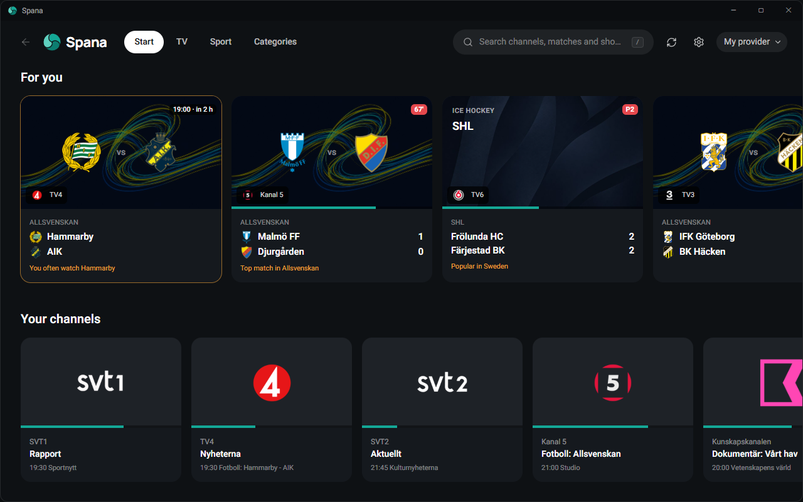
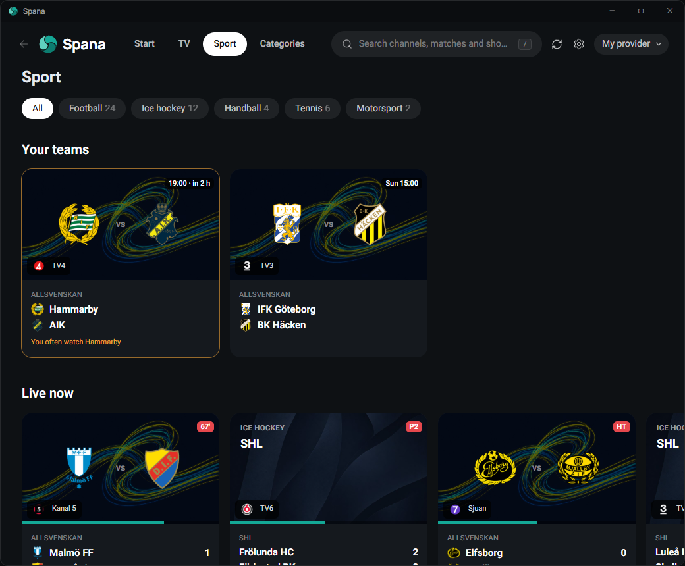
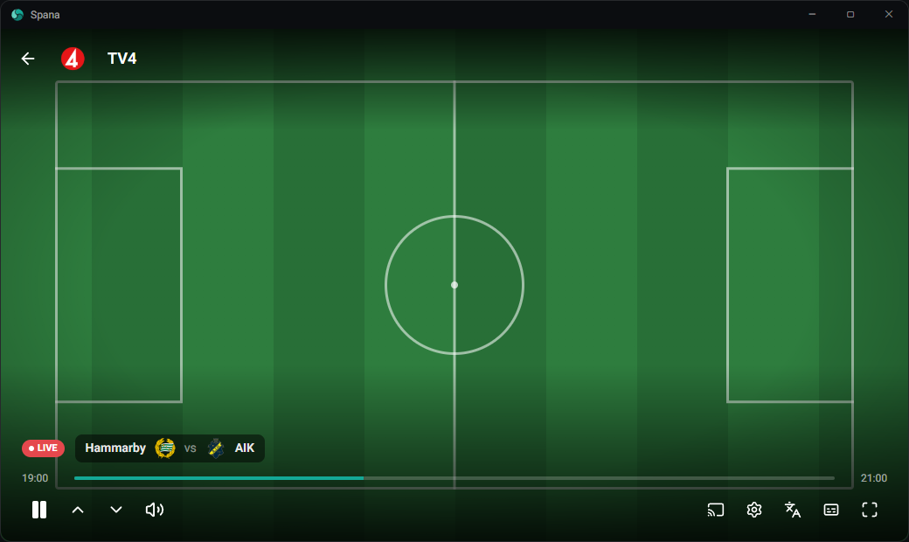
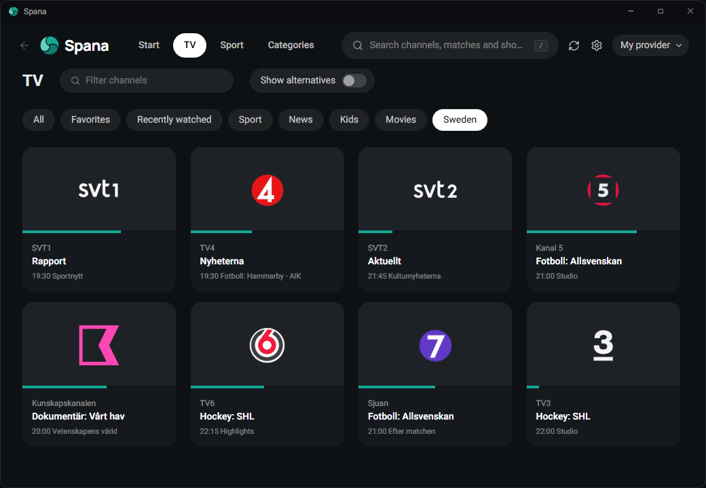
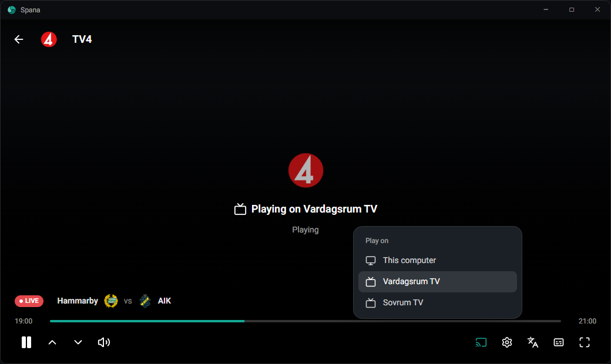

<p align="center">
  
</p>

<h1 align="center">Spana</h1>

<p align="center">
  <b>Your IPTV, finally easy to watch.</b><br>
  A fast IPTV player for Windows with live TV, sport, a real program guide and suggestions that learn what you watch.<br>
  Works with Xtream Codes and M3U providers.
</p>

<p align="center">
  <a href="https://spana.tv">spana.tv</a>
</p>

<p align="center">
  
</p>

> The images show the app with example content. Spana is a player and comes with no channels. Bring your own provider, one you have the right to use. See the [Terms of Use](https://spana.tv/terms).

## Never miss a match

Spana reads your program guide and builds a sport schedule from it: what is live, what starts soon and what is on tomorrow, across every channel you have. Club crests and live scores are added from public match data, and games with the teams you watch are highlighted. Watch Hammarby a few times and their next match shows up on your start page.



## A player made for live TV

Pause a live match and pick up where you left off, or jump back to the live broadcast. Change channel with the arrow keys without leaving fullscreen. The player never shows the score, so a goal is not spoiled before you see it, and your audio track and subtitles are remembered per channel.



## Every channel, with what is on now

Provider lists are messy. Spana cleans up channel names, hides duplicate HD and SD versions and sorts everything into sport, news, kids, movies and countries. Each channel shows the programme on right now and what comes next.



## Send it to the TV

Pick a smart TV in the cast menu and the stream moves over. No app is needed on the TV; it works with TVs that support DLNA, which includes most LG, Samsung, Sony and Philips models.



## Also

- Search channels and the program guide at once
- Channel lists, the guide, logos and posters are cached on disk and refreshed in the background, so the app opens instantly
- Hardware decoding through LibVLC for smooth 1080p and 4K
- Mini player while you browse, and several provider accounts
- Movies, series and a library can be turned on in Settings
- No account and no ads: everything stays in `%AppData%\Spana` on your PC. Match data is fetched through spana.tv

## Shortcuts

| Key | Action |
| --- | --- |
| Space / K | Play or pause |
| F | Fullscreen |
| M | Mute |
| Left / Right | Seek 10 s (Shift for 60 s) |
| Up / Down | Volume, or switch channel when watching live TV |
| / or Ctrl+K | Search |
| Esc / Backspace / Mouse back | Go back |

## Match data

Sport cards are enriched from public sports and TV guide services, fetched for you by Spana's API at spana.tv and cached for everyone: one polite request instead of every installation asking the same sources. Everything is also cached locally and refreshed in the background, and all of it can be switched off under Settings, Match data.

When a source is unavailable the app keeps working with the program guide alone.

Match data requests go through spana.tv, so the server sees your IP address and what you ask for, and nothing else about you. Your provider, its streams and your program guides still connect directly from your PC. See the [privacy policy](https://spana.tv/privacy).

## Building

Requires the .NET 10 SDK and Node.js.

```
dotnet build -c Release
```

The frontend in `Frontend/` is built automatically as part of the .NET build and embedded into the executable.

In VS Code, press F5 to build and start the app. Pick "Spana (Vite hot reload)" in the Run panel to start the Vite dev server as well and get instant frontend reloads.

## Releasing

Releases are built by GitHub Actions and published as GitHub Releases, which the app updates from with Velopack.

1. Run **Create Prerelease** and pick patch, minor or major. It builds `vX.Y.Z-beta.N` and publishes it as a prerelease.
2. When the beta is good, run **Create Release** with that beta tag. It rebuilds the same code as `vX.Y.Z` and publishes it as the latest release.

To release without a beta, run **Create Release** with the beta tag left empty and pick patch, minor or major. It builds the current `main` as the next version.

The app checks for updates on startup and every 4 hours, downloads them in the background and shows an update button in the top bar. Under Settings, Updates, users choose Stable (final releases only) or Beta (prereleases too).

## How it works

The app is a .NET host using Photino for the window and a React frontend styled with Tailwind and daisyUI. Playback runs through LibVLC. Decoded frames are sent to the webview over a local WebSocket and drawn with WebGL, so the player controls are regular HTML on top of the video. Casting uses UPnP AV (DLNA): VLC restreams on loopback and a small relay serves the TV.

## License

[PolyForm Strict 1.0.0](LICENSE): free for noncommercial use, no changes or redistribution. Third-party components are listed in [THIRD-PARTY-NOTICES.md](THIRD-PARTY-NOTICES.md). Contributions are welcome under the exception in [CONTRIBUTING.md](CONTRIBUTING.md) and require signing the [CLA](CLA.md).
